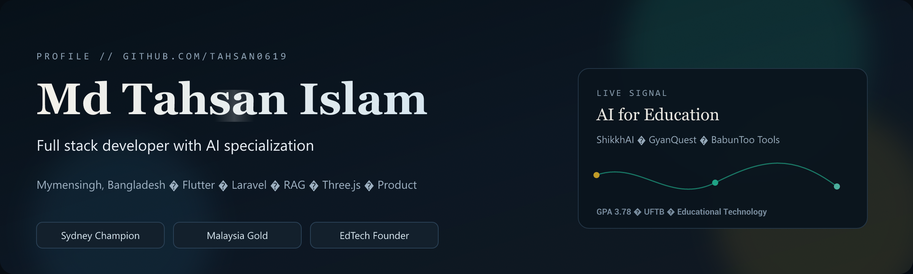
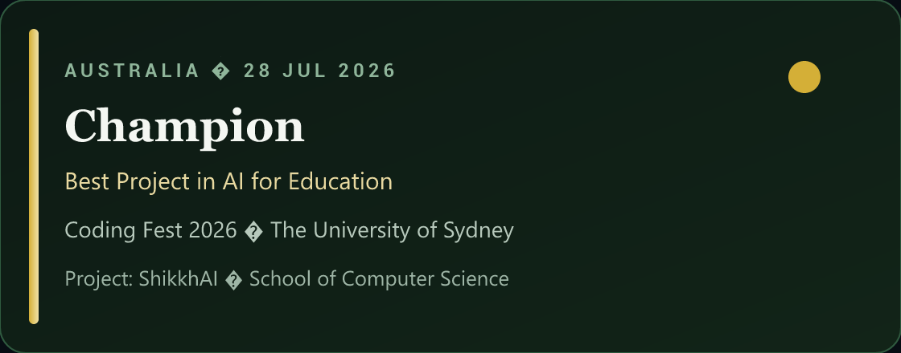
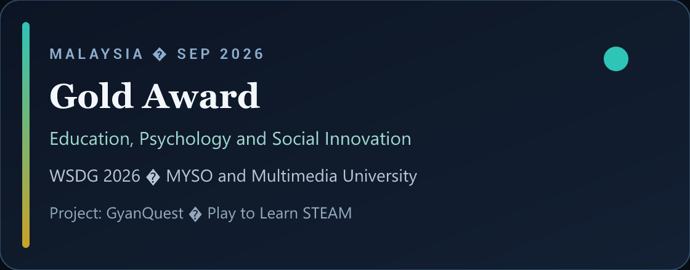
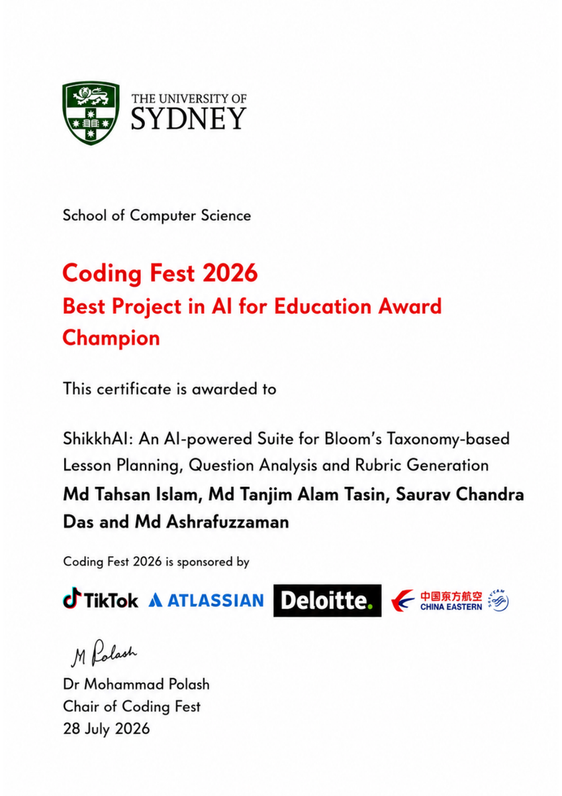
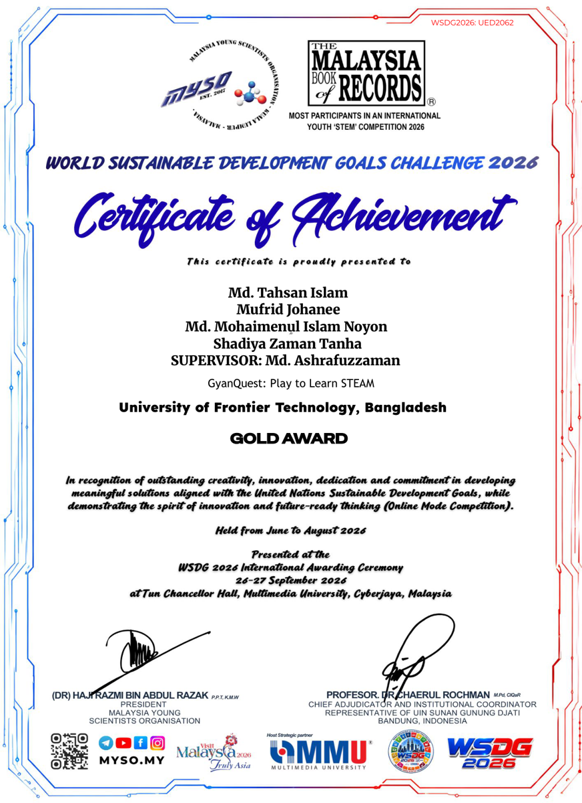
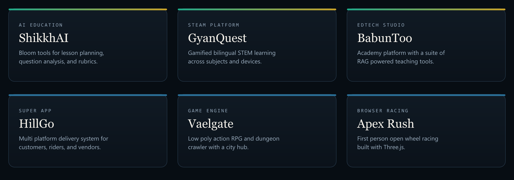

<p align="center">
  
</p>

<p align="center">
  <a href="https://tahsan.babuntooacademy.com"><strong>Portfolio</strong></a>
  ·
  <a href="https://linkedin.com/in/tahsan-islam-babun"><strong>LinkedIn</strong></a>
  ·
  <a href="https://raw.githubusercontent.com/Tahsan0619/Tahsan0619/main/cv/Md_Tahsan_Islam_CV.pdf"><strong>CV (PDF)</strong></a>
  ·
  <a href="mailto:tahsanislam303@gmail.com"><strong>Email</strong></a>
</p>

<br/>

I build products at the intersection of **education**, **AI systems**, and **shippable software**.

Founder of **BabunToo Academy**. Full stack developer with a focus on Flutter, Laravel, RAG pipelines, and interactive experiences. Recent international recognition includes a **Champion** award at Coding Fest 2026 (University of Sydney) and a **Gold Award** at WSDG 2026 (Malaysia).

<p align="center">
  
</p>

## International recognition

<p align="center">
  
  
</p>

<table>
  <tr>
    <td width="50%" valign="top">
      <p align="center"><strong>University of Sydney · Australia</strong></p>
      <p align="center">
        <a href="https://raw.githubusercontent.com/Tahsan0619/Tahsan0619/main/assets/codingfest-sydney.png">
          
        </a>
      </p>
      <p>
        <strong>Champion</strong> for Best Project in AI for Education at Coding Fest 2026 (28 July 2026), School of Computer Science, The University of Sydney.
        Project: <a href="https://github.com/Tahsan0619/ShikkhAI">ShikkhAI</a>, an AI suite for Bloom taxonomy lesson planning, question analysis, and rubric generation.
      </p>
    </td>
    <td width="50%" valign="top">
      <p align="center"><strong>Multimedia University · Malaysia</strong></p>
      <p align="center">
        <a href="https://raw.githubusercontent.com/Tahsan0619/Tahsan0619/main/assets/wsdg-gold.png">
          
        </a>
      </p>
      <p>
        <strong>Gold Award</strong> at the World Sustainable Development Goals Challenge (WSDG) 2026, organized with MYSO and Multimedia University, Cyberjaya.
        Project: <a href="https://github.com/Tahsan0619/GyanQuest">GyanQuest</a>, a gamified STEAM learning platform recognized for education, psychology, and social innovation.
      </p>
    </td>
  </tr>
</table>

<details>
  <summary><strong>More awards and selection highlights</strong></summary>
  <br/>
  <ul>
    <li><strong>1st Runner Up</strong> · RoboFusion 1.0, National Robotics Fest 2026 · GyanQuest</li>
    <li><strong>Grand Finalist</strong> · BrainChild Season 2.0, Jagannath University AI and IT Fest 2026</li>
    <li><strong>Grand Finalist</strong> · ImpactX 2026, STEAM Club UFTB</li>
    <li><strong>Co Fellow</strong> · BRAC AI Fellowship, BRAC RHRN 2025</li>
    <li><strong>5th Place</strong> · HULT Prize In Campus · BabunToo Academy</li>
    <li><strong>Semi Finalist</strong> · Banglalink AppLink Hackathon · BabunToo Academy</li>
    <li><strong>Regional Champion</strong> · Physics Olympiad 2020 and ICT Olympiad 2016</li>
  </ul>
</details>

<p align="center">
  
</p>

## What I work on

**BabunToo Academy** is my EdTech studio and product home. I lead design and engineering across mobile, web, and AI tool suites for teachers and learners, including RAG systems on Supabase pgvector with Llama models via Groq.

<ul>
  <li><strong>AI for Education</strong> · ShikkhAI, Bloom tools, lesson and rubric generators, Reverse Co Pilot</li>
  <li><strong>Learning products</strong> · GyanQuest, BabunToo Academy platform</li>
  <li><strong>Platforms</strong> · HillGo multi app delivery, MindTrack Piaget assessment</li>
  <li><strong>Creative engines</strong> · NovaScript visual novel engine, browser games in Three.js</li>
  <li><strong>Research</strong> · BLyzer paper under review (Bloom taxonomy classification with NLP)</li>
</ul>

<p align="center">
  
</p>

## Selected repositories

<p align="center">
  
</p>

<p align="center">
  <a href="https://github.com/Tahsan0619/ShikkhAI">ShikkhAI</a>
  ·
  <a href="https://github.com/Tahsan0619/GyanQuest">GyanQuest</a>
  ·
  <a href="https://github.com/Tahsan0619/babuntoo-academy">BabunToo</a>
  ·
  <a href="https://github.com/Tahsan0619/Hill-Go-All">HillGo</a>
  ·
  <a href="https://github.com/Tahsan0619/vaelgate">Vaelgate</a>
  ·
  <a href="https://github.com/Tahsan0619/apex-rush">Apex Rush</a>
</p>

<p align="center">
  
</p>

## Toolkit

```text
Languages    Dart · Python · JavaScript · PHP · C/C++ · HTML/CSS
Mobile/Web   Flutter · React · Laravel · Node · Supabase
AI           RAG · pgvector · Llama (Groq) · NLP · Bloom tooling
Creative     Three.js · Unreal · Ren'Py · NovaScript · design media
Practice     Product ownership · Agile delivery · AI native workflows
```

<p align="center">
  
</p>

## Education and contact

**B.Sc. Educational Technology and Engineering** · University of Frontier Technology Bangladesh · GPA **3.78 / 4.00**

Based in **Mymensingh, Bangladesh**. Open to collaboration on EdTech, AI products, research builds, and ambitious client work.

<ul>
  <li>Portfolio · <a href="https://tahsan.babuntooacademy.com">tahsan.babuntooacademy.com</a></li>
  <li>LinkedIn · <a href="https://linkedin.com/in/tahsan-islam-babun">tahsan-islam-babun</a></li>
  <li>Email · <a href="mailto:tahsanislam303@gmail.com">tahsanislam303@gmail.com</a></li>
  <li>CV · <a href="https://raw.githubusercontent.com/Tahsan0619/Tahsan0619/main/cv/Md_Tahsan_Islam_CV.pdf">Download PDF</a></li>
</ul>

<p align="center">
  <sub>Built as a living profile, not a template dump. Certificates hosted in this repository.</sub>
</p>
